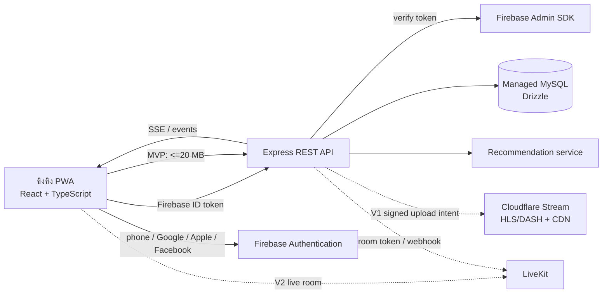
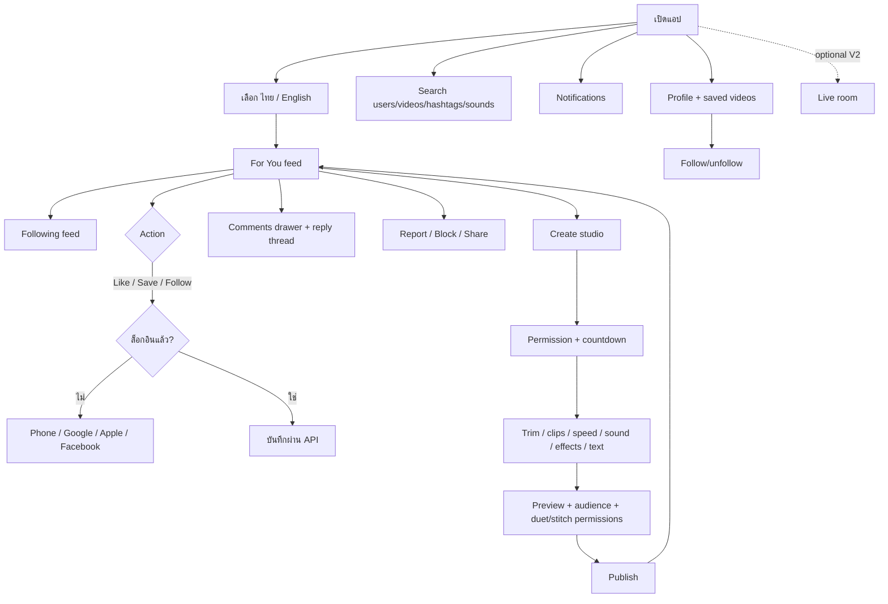

# ขิงขิง — Product Architecture & Build Plan

**สถานะ:** เอกสารออกแบบผลิตภัณฑ์และ implementation guide สำหรับแอปวิดีโอสั้นภาษาไทย/อังกฤษ
**ชื่อผลิตภัณฑ์:** ขิงขิง (Khing Khing)
**กลุ่มเริ่มต้น:** ผู้ชมและครีเอเตอร์ทั่วไป โดยใช้ช่วงอายุ 16–35 ปีเป็นสมมติฐานจากตัวอย่างในโจทย์ ยังไม่ใช่นโยบายอายุที่ประกาศแล้ว

> เอกสารนี้ออกแบบครบตาม feature list และมีโค้ด algorithm ที่ทดสอบได้ แต่ไม่ได้อ้างว่าฟีเจอร์ social ทั้งหมดเปิดใช้งานจริงแล้ว โปรเจกต์ปัจจุบันมี short-video-style feed, public upload, private archive และเกม; authentication, social graph, comments, notification, editor, moderation และ live ต้องพัฒนา/เชื่อมผู้ให้บริการใน roadmap ต่อไป

## 1. Product decisions

- **Frontend:** React + TypeScript + Vite แบบ responsive PWA บนเว็บ เพื่อใช้โค้ดปัจจุบันต่อ ไม่ย้ายไป native iOS/Android ในรอบนี้
- **Backend:** Node.js + Express REST API เดิม แยก route, service และ worker ตาม feature
- **Database:** Managed MySQL + Drizzle สำหรับ user/profile, graph, interactions, search metadata และ aggregate metrics
- **Authentication:** Firebase Authentication สำหรับ phone, Google, Apple และ Facebook; backend ตรวจ Firebase ID token แล้ว map provider identity ไปยัง social account เดียว
- **Video storage:** MVP คง Managed MySQL BLOB และ 20 MB/ไฟล์ตามการตั้งค่าที่ผู้ใช้อนุมัติก่อนหน้านี้; เป้าหมาย V1 คือ Cloudflare Stream สำหรับ direct upload, encoding, HLS/DASH และ CDN หลังอนุมัติ migration
- **Realtime:** SSE สำหรับ inbox/activity ใน single-instance MVP; shared event bus หรือ Socket.IO + Redis เมื่อมีหลาย instance
- **Video processing:** Browser `MediaRecorder`/Canvas สำหรับ capture/preview; final multi-clip render และ adaptive streaming ส่งให้ transcoding worker/video provider ใน V1
- **Live:** LiveKit ใน V2 เป็น optional ตามโจทย์; ยังไม่มี provider credentials/room service
- **Upload permission:** คง guest public upload ที่มีอยู่เป็นค่าเริ่มต้น เพราะเป็นพฤติกรรมที่ผู้ใช้อนุมัติแล้ว; account จำเป็นสำหรับ follow, like, comment, bookmark, profile และ notifications. การบังคับ login ก่อนโพสต์ต้องเป็นการเปลี่ยน policy ที่ผู้ใช้ยืนยันแยกต่างหาก

เว็บไซต์ขิงขิงที่มีอยู่ยังคงเป็น production version จนกว่าจะมี checkpoint และได้รับคำยืนยันก่อน publish เวอร์ชันใหม่ เอกสาร schema ด้านล่างเป็น proposal เท่านั้น ไม่ได้ apply กับ Managed Database

## 2. App architecture



### Bounded contexts

1. **Identity & profile:** Firebase เป็น authentication authority; DB เก็บ `handle`, `bio`, avatar reference, locale, theme และ role ของแอปเท่านั้น ไม่เก็บรหัสผ่านหรือ provider secret
2. **Video & upload:** สร้าง draft → ตรวจ mime/size/duration → เก็บไฟล์ → publish; API ส่งเฉพาะ metadata และ stable playback address ให้ feed
3. **Social graph:** follow state, likes, bookmarks และ blocks ใช้ unique constraints เพื่อทำ request ซ้ำได้โดยไม่เพิ่มยอดซ้ำ
4. **Conversation & inbox:** comment/reply และ notification เก็บใน MySQL; realtime เป็น transport เสริม ไม่ใช่แหล่งข้อมูลหลัก
5. **Discovery & ranking:** สร้าง candidate set จาก public posts, followed creators, interests และ trends; safety/visibility filters ทำก่อน scoring
6. **Trust & safety:** report queue, moderation status และ blocks มีผลใน feed, search, comments, profile และ inbox พร้อมกัน
7. **Live:** LiveKit เป็น media plane; DB เก็บ room state/host metadata; provider webhook เป็นแหล่งยืนยัน lifecycle ของ room

### Route contract ที่แนะนำ

| Endpoint | หน้าที่ |
|---|---|
| `GET /api/feed?tab=for-you|following&cursor=...` | Cursor feed; Following chronologically, For You ranked |
| `POST /api/auth/session` | ตรวจ Firebase ID token และสร้าง/โหลด social profile; ไม่รับ provider password |
| `POST /api/videos/upload-intent` | สร้าง draft และ upload URL; MVP รับไฟล์ผ่าน API, V1 ออก one-time provider upload URL |
| `POST /api/videos/:id/publish` | ตรวจ duration/status, caption/hashtags, permissions แล้ว publish |
| `GET /api/videos/:id` / `DELETE /api/videos/:id` | อ่าน metadata / soft-delete โดย owner หรือ moderator |
| `PUT` / `DELETE /api/videos/:id/like` | Like/unlike แบบ idempotent |
| `PUT` / `DELETE /api/users/:id/follow` | Follow/unfollow; private profile ใช้ pending/accepted |
| `PUT` / `DELETE /api/videos/:id/bookmark` | Save/unsave ส่วนตัว |
| `GET` / `POST /api/videos/:id/comments` | Comments และ replies; limit และ cursor pagination |
| `GET /api/search?q=&type=users|videos|hashtags|sounds` | Search ทุก entity ที่ผู้ค้นหามีสิทธิ์เห็น |
| `GET /api/notifications` / `GET /api/events` | Inbox history / event stream ที่ตรวจ auth |
| `POST /api/reports` / `PUT /api/users/:id/block` | Report content/user และ block/unblock |
| `POST /api/live/rooms` / `POST /api/live/:id/token` | สร้าง room/ออก short-lived provider token ใน V2 |

All protected mutations resolve the user from a verified token. Never trust `userId`, counter values, visibility or owner ID sent by the client. Use cursor pagination, server-side block filters, no-store for private APIs, rate limiting and audit logs that never contain auth or delete bearer tokens.

## 3. Database design

Full MySQL proposal with indexes and foreign keys: [`khingkhing-social-schema.sql`](./khingkhing-social-schema.sql). It is **not applied**; existing `users` and `public_media` tables stay untouched.

| Entity | Primary responsibilities |
|---|---|
| `social_users`, `social_auth_identities` | Profile + multiple providers linked to one Firebase UID; unique handle and provider subject |
| `social_videos` | Owner, caption, visibility/status, 15–180 s duration, storage backend, legacy media ID, edit recipe, duet/stitch source, permissions and counters |
| `social_sounds` | Licensed/original sound metadata, asset key, duration and usage status |
| `social_follows` | Follower/following graph and pending state for private accounts |
| `social_video_likes`, `social_bookmarks` | Unique user/video interactions |
| `social_comments` | Threaded replies through `parent_id`, moderation status and cursors |
| `social_hashtags`, `social_video_hashtags` | Hashtag search and trend mapping |
| `social_video_daily_metrics` | Impressions, qualified views, completions, rewatches and watch time for ranking |
| `social_notifications` | Like/comment/reply/follow/mention/tag events and read state |
| `social_blocks`, `social_reports` | Safety filters and moderation work queue |
| `social_live_rooms` | Host, provider room ID and live lifecycle in V2 |

`social_videos` is a design target; a migration would map current `public_media.id` to `legacy_media_id` and preserve current delete capabilities before any storage transition. Database constraints prevent self-follow/block and enforce MVP duration/size; API still validates ownership, media headers, rate and provider state.

## 4. UX/UI flow



### Screen details

- **For You:** edge-to-edge portrait video, swipe/scroll snap, muted autoplay/loop, tap-to-pause, safe-area action rail; overlay shows creator, caption/hashtags, licensed sound, likes/comments/shares/views.
- **Following:** chronological feed from accepted follow graph, with explicit empty state (“ติดตามครีเอเตอร์เพื่อเริ่มดู / Follow creators to start”).
- **Create:** capture or select 15-second–3-minute segments; countdown 0/3/10 seconds; editor timeline, trim handles, reorder, speed, sound picker, effects/filter, sticker, text overlays, preview and publish state.
- **Comments:** bottom sheet with one-level threaded reply, report/delete ownership controls, loading/empty/error states, and live update marker.
- **Profile:** avatar, bio, follower/following/likes, Follow/Unfollow, public clips, saved videos private to owner.
- **Discover:** search input + Users/Videos/Hashtags/Sounds facets; category chips and trending rows; Thai/English matching.
- **Inbox:** grouped notifications with read/unread, tap to the relevant profile/video/comment.
- **Safety:** report reason selection, block confirmation, hide blocked accounts from every feed/search/comment query.
- **Settings:** language ไทย/English and Dark/Light/System, privacy, blocked list, account linking/deletion.
- **Responsive:** bottom nav Feed/Discover/Create/Inbox/Profile on mobile; left nav + content + details rail on desktop; comments/editor open as sheets on phones.

Visual direction: dark high-contrast mobile video canvas, lime `#d9ff55` brand accent, warm white type, cyan state indicator and the existing custom “ขิงขิง” play-frame mark. Use IBM Plex Sans Thai for Thai UI and Inter/Space Grotesk for Latin/numerals. No TikTok name, icon or proprietary media is reused.


## 5. Core recommendation algorithm

The implemented, dependency-free ranker is [`server/recommendation.ts`](../server/recommendation.ts), with tests in [`server/recommendation.test.ts`](../server/recommendation.test.ts). It is intentionally **not wired** to production `/api/feed`: the current media table has no authenticated creator graph or engagement history.

### Candidate generation

For You candidates come from fresh public posts, creator interests/hashtags, followed creators, local trends and an exploration pool. First exclude drafts, removed/blocked/private posts, blocked authors and the viewer's own content. Apply safety and eligibility filtering before scoring. Following is a different query: accepted follows only, ordered newest first.

### MVP score

```text
score(video) =
  3.20 * watch_ratio
+ 1.40 * rewatch_rate
+ 1.70 * normalized_share_rate
+ 1.25 * normalized_save_rate
+ 1.10 * normalized_like_rate
+ 0.80 * normalized_comment_rate
+ 0.90 * hashtag_interest_match
+ 0.55 * exp(-age_hours / 96)
+ 0.25 * followed_creator_boost
- 1.80 * skip_rate
```

Each action rate is `log1p(actions) / log1p(max(views,1))`, clamped to `[0,1]`; watch ratio is average watch seconds divided by duration, capped at `1.5`. The pure implementation then breaks ties deterministically and limits a creator to three items per page by default.

Measure a qualified view after at least 2 seconds (or a reasonable share of very short clips), record watch milliseconds/completion/rewatch separately, and deduplicate view aggregates by user-video-day. Do not equate impressions with views. Keep a small exploration share (for example 15%) for new creators and topics to prevent a feedback loop; put that randomized candidate sampling in the service layer, not in this deterministic ranker. Tune weights only from consented, aggregated engagement and abuse/satisfaction outcomes; reports, blocks, rapid skips and “not interested” signals must reduce ranking.

## 6. Important implementation patterns

### Authentication

Client flow: Firebase SDK returns an ID token → send it as `Authorization: Bearer <token>` → server Firebase Admin verifies signature/audience/expiry → resolve or create `social_users` by Firebase UID → authorization check. Never accept the profile ID from a request body as authority. Provider setup requires Firebase console settings and redirect domains; secrets/credentials must be entered through the protected WebDev secret workflow, never chat.

### Capture and upload

1. Ask camera/microphone permission only after user presses Create.
2. Record WebM/MP4 chunks with `MediaRecorder`; stop at 180 seconds, reject clips shorter than 15 seconds.
3. Preview with `URL.createObjectURL`; revoke it on unmount. For MVP, enforce the existing 20 MB cap; choose a bitrate budget suitable for a three-minute clip.
4. Validate duration, MIME signature, size and orientation on the server. Use idempotency key for retried uploads.
5. Create metadata record as `processing`; publish only after media validation succeeds. V1 can return a short-lived direct-upload URL from Cloudflare Stream, receive its signed webhook, then set `published`.

The current API's 20 MB BLOB path is appropriate only as a small MVP; it does not provide transcoding, adaptive bitrates or a global CDN. The three-minute cap at 20 MiB allows roughly **0.93 Mbps total bitrate** before container overhead; compression and quality trade-offs must be explicit.

### Safety and privacy

- Existing guest uploads remain public immediately and are not silently migrated; this behavior currently has no moderation queue or total storage quota.
- New account interactions require verified identity; media owner controls edit/delete. Report/block must affect all read surfaces, not merely hide a client card.
- Use server-side rate limits, upload byte/duration caps, MIME sniffing, antivirus/decoder checks where available, text length limits, comment anti-spam and audit trails.
- Store provider secrets server-side. Keep phone/email only when needed; do not store raw IP as a permanent view identity. Use short-lived auth tokens and never log Authorization, Firebase tokens, LiveKit token, or upload/delete capability.
- Public music library must contain owned or licensed audio. Unlicensed popular songs are not seeded.
- The SQL proposal includes `social_reports`, but a moderation dashboard and human response process still need implementation before claiming trust & safety is complete.
- “Delete” removes the current DB row/provider asset; it cannot promise removal from provider backups or database binlogs beyond provider retention.

## 7. Requirement coverage and status

| Requested capability | Design/implementation path | Current status |
|---|---|---|
| For You and Following; vertical, full screen, autoplay/loop | Feed API + deterministic ranker + accepted-follow query | Existing vertical feed is present; For You/Following backend not wired |
| Like/comment/share/view counts | Unique interactions, comment table and aggregate metrics | Not yet account-backed |
| 15 sec–3 min camera, countdown, edit/merge/speed | MediaRecorder, editor timeline and transcode provider | UX/architecture specified; studio not implemented |
| Music, effects, filters, stickers, text | Licensed sound catalog + edit recipe/render pipeline | Schema/flow specified; catalogs/rendering not connected |
| Duet/Stitch | `remix_type`, `source_video_id`, source permission checks | Schema proposed; UI/API not implemented |
| Phone/Google/Apple/Facebook; profile/follow/save | Firebase Auth + linked identities + social profile graph | Provider account/credentials absent; not live |
| Comment replies and notifications | `social_comments`, `social_notifications`, SSE | Schema/API path specified; not live |
| Search users/video/hashtags/sounds | API facets, indexed handles/tags; add Thai-aware search service if needed | Design only |
| Live streaming | LiveKit room tokens/webhooks | Optional V2; not configured |
| Report/block | DB queue and universal read filters | Schema only; no active moderation ops |
| Thai/English + Dark Mode | i18n catalog and locale/theme preference | Design only |
| MVP recommendation algorithm | `server/recommendation.ts` plus tests | Implemented as a standalone core; not connected to API |

## 8. Phased delivery plan

### MVP — identity, feed and safety baseline

- Configure Firebase Auth providers for phone/Google/Apple/Facebook and account linking; secure ID-token verification and profile creation.
- Decide and record whether current anonymous public upload stays open; preserve existing private archive and deletion semantics.
- Add `social_*` migration additively; implement public/private/followers visibility, feed cursors, For You/Following, likes, bookmarks, comments/replies, counts and creator profiles.
- Add basic report/block workflows, upload limits, content visibility controls and staff queue before growth; keep notification delivery in inbox with polling/SSE.
- Implement Thai/English catalogs, dark/light/system mode, responsive UI, camera capture/countdown, 15–180 second duration and browser preview.
- Launch initially with existing 20 MB DB-backed media path only if test traffic is small and storage limits are monitored.

### V1 — creator tools and scale readiness

- Migrate media to Cloudflare Stream only after explicit approval, with a copy/verify/cutover/rollback plan; add adaptive playback, thumbnails, webhook handling and deletion lifecycle.
- Implement multi-segment trim/reorder/speed, licensed sound library, text/sticker/effects, duet/stitch source links and final render job state.
- Add Thai-aware search, notification SSE/event fanout, creator analytics, “not interested”, creator caps and controlled exploration.
- Add moderation dashboard, duplicate/spam controls, account appeals, rate limits, storage quotas and retention policy.

### V2 — live and personalization

- LiveKit rooms with host/viewer roles, room token lifecycle, moderation controls, reporting, reconnect flow and optional recording/egress.
- Scale event fanout through shared message bus, separate video/media delivery from relational metadata, and use ranking experiments with feature flags and holdout groups.
- Add advanced safety operations, accessibility reviews, data export/deletion workflows and regional/privacy compliance appropriate to launch markets.

## 9. Official references

- [Firebase Authentication](https://firebase.google.com/docs/auth/) — provider sign-in and identity integration.
- [Cloudflare Stream direct creator uploads](https://developers.cloudflare.com/stream/uploading-videos/direct-creator-uploads/) — browser upload without exposing the account API token.
- [Cloudflare Stream delete API](https://developers.cloudflare.com/api/resources/stream/methods/delete/) — provider-level deletion path for a future storage migration.
- [LiveKit basics](https://docs.livekit.io/intro/basics/) and [egress](https://docs.livekit.io/transport/media/ingress-egress/egress/) — room media and publishing/recording architecture.
- [Unsplash License](https://unsplash.com/license) — reference image usage terms; image is a mood sample, not user content.
